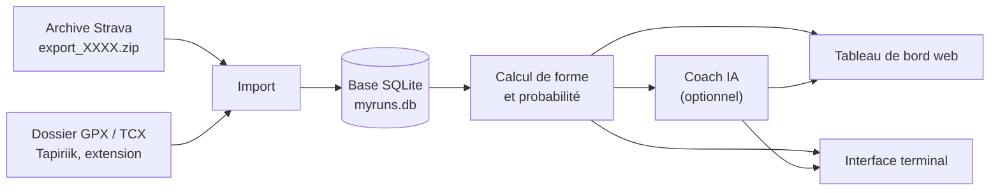

# Présentation

## Introduction

MyRuns récupère les activités sportives enregistrées sur Strava et estime les chances de réussir
un objectif de course, par exemple « 55 % de chances de courir 10 km en 45 minutes le 15 décembre ».
Elle s'utilise comme une application Windows (fenêtre MyRuns), depuis un navigateur sur le poste
de développement, ou depuis un terminal.

| Environnement | Adresse |
|---|---|
| Application Windows | Menu Démarrer → **MyRuns** (installeur publié sur la page *Releases* du dépôt GitHub) |
| Poste de développement (DDEV) | [https://mystrava.ddev.site](https://mystrava.ddev.site) |
| Interface terminal | `ddev exec bin/console tui`, dans le dossier du projet |

Chaque personne a sa propre installation et ses propres données : rien n'est partagé entre les
utilisateurs.

## Objet / Contexte

L'API Strava n'est pas utilisée. MyRuns lit l'**archive officielle** que Strava envoie par e-mail
sur demande, ainsi que des dossiers de traces GPS (GPX/TCX) remplis par des outils tiers
(Tapiriik, extension de navigateur).

À partir des sorties des 12 dernières semaines, l'application calcule un niveau de forme, le
projette jusqu'à la date de l'objectif et en déduit un pourcentage de réussite. Un « coach IA »
peut ensuite commenter ce résultat et proposer des conseils d'entraînement.

## Contacts

<span style="text-decoration: underline;">**Internes**</span>

- Projet personnel de L. Guigo (dépôt `mystrava`)

<span style="text-decoration: underline;">**Externes**</span>

- Strava : export de compte depuis les paramètres du compte
- Anthropic (Claude) : modèle utilisé par le coach IA — [documentation](https://docs.anthropic.com)

# Architecture

## Vue d'ensemble

| Répertoire | Rôle |
|---|---|
| `src/Import/` | Lecture de l'archive Strava (`activities.csv`) et des fichiers GPX/TCX |
| `src/Elevation/` | Dénivelé recalculé sur l'altitude du terrain (IGN en France, Open-Meteo ailleurs) |
| `src/Http/` | Garde-fous des services publics appelés à l'import (délai, pannes, cadence) |
| `src/Entity/`, `src/Repository/` | Activités, profil du coureur, courses officielles (base SQLite) |
| `src/Settings/` | Clés d'accès saisies dans la page *Réglages* (fichier `settings.json`) |
| `src/Prediction/` | Niveau de forme (VDOT), projection et pourcentage de réussite |
| `src/Ai/` | Coach IA : envoi de l'historique au modèle et réponse structurée |
| `src/Controller/`, `templates/`, `assets/` | Tableau de bord web |
| `src/Tui/` | Interface terminal |
| `src/Command/` | Commandes `tui`, `app:import`, `app:predict`, `app:sync` |
| `desktop/` | Application de bureau Windows (Tauri) : fenêtre, PHP embarqué, installeur |
| `.github/workflows/desktop.yml` | Fabrication de l'installeur Windows à chaque version (tag `v…`) |

## Schéma fonctionnel / flux



## Schéma technique / système

- PHP 8.4, Symfony 8.1
- Application Windows : fenêtre Tauri (moteur WebView2 de Windows) qui lance un PHP 8.4 embarqué
  (serveur web interne de PHP sur `127.0.0.1`, port choisi au démarrage) et l'arrête à la fermeture
- Poste de développement : servi par DDEV (nginx + PHP-FPM)
- Base SQLite (un fichier `myruns.db` par installation), Doctrine ORM
- Pages web en Twig, sans framework JavaScript ; graphiques dessinés côté serveur
- Composant `symfony/tui` (expérimental) pour l'interface terminal
- Symfony AI 0.14 avec la plateforme Anthropic pour le coach IA

## Schéma réseau

- Flux entrant : aucun depuis le réseau. L'application Windows écoute uniquement sur `127.0.0.1`
  (le poste lui-même) ; en développement, HTTPS local `mystrava.ddev.site` (routeur DDEV).
- Flux sortants : HTTPS vers intervals.icu (synchro des séances), vers l'IGN `data.geopf.fr`
  (altitude du terrain, à l'import d'une trace GPS) et vers l'API Anthropic (seulement quand on
  lance l'analyse IA).

# Développement

## Environnement dev. technique

- Démarrage : `ddev start` (la première fois, demande le mot de passe `sudo` pour `/etc/hosts`).
- Dépendances : `ddev composer install`, puis `ddev exec bin/console doctrine:migrations:migrate -n`.
- Variables à renseigner dans `.env.local` (prioritaires sur la page *Réglages*) :
  - `ANTHROPIC_API_KEY` : clé du coach IA (jamais dans un fichier commité)
  - `AI_MODEL` : modèle utilisé (défaut `claude-sonnet-5`)
  - `STRAVA_EXPORT_PATH` : dossier importé par défaut (défaut `imports`, relatif au projet)
  - `INTERVALS_API_KEY`, `INTERVALS_ATHLETE_ID` : synchro intervals.icu (clé en bas de la page
    Paramètres d'intervals.icu ; identifiant vide = propriétaire de la clé)
  - `MYRUNS_DATA_DIR` : dossier des données (défaut `var/` du projet)
- Tests : `ddev exec vendor/bin/phpunit` (base `var/test.db`, l'IA est simulée).
- Application de bureau : `bin/prepare-desktop-app` (prépare `desktop/build/app`), puis
  `cargo tauri dev` dans `desktop/src-tauri` (PHP du poste, avec l'extension `pdo_sqlite`).
- Liste des pages : `ddev exec bin/console debug:router` ; des commandes : `ddev exec bin/console list app`.

## Base de données

SQLite : un fichier `myruns.db` dans le dossier des données (application Windows : voir
*Installation locale* ; développement : `var/myruns.db`, tests : `var/test.db`).

| Table | Contenu |
|---|---|
| `activity` | Une ligne par sortie : identifiant (n° Strava ou nom du fichier), type de sport, date de départ, distance, durées, dénivelé (celui de la source et celui recalculé sur le terrain), fréquence cardiaque moyenne, source (CSV ou trace) |
| `athlete_profile` | Une seule ligne : FC max et de repos, année de naissance, année de début de la course, poids actuel et visé (tous facultatifs), dernier objectif saisi (distance, temps, date), réglages du programme (sorties par semaine, jour et heure du club) |
| `training_week_override` | Ajustements du programme par semaine (lundi de la semaine, club oui/non, nombre de sorties) |
| `race_result` | Courses officielles saisies : date, distance, temps, nom |
| `activity_split` | Temps de passage : un kilomètre calculé ou un tour de la montre par ligne (distance, temps, FC moyenne et max, D+) |

Le schéma est géré par les migrations Doctrine (`migrations/`), appliquées automatiquement à
chaque ouverture de l'application Windows. Les activités se reconstruisent par un nouvel import ;
le profil, les courses officielles et les ajustements du programme, non : sauvegarder
`myruns.db`.

# Interfaces / dépendances

## API / webservice

- **API exposée** : aucune (pages web uniquement).
- **API consommée** :
  - API intervals.icu (lecture seule) : nouvelles séances et leur fichier d'origine, FC de repos.
    Clé personnelle saisie dans *Réglages* (ou `INTERVALS_API_KEY`).
  - API Anthropic (Messages), seulement pour le coach IA ; clé saisie dans *Réglages* (ou
    `ANTHROPIC_API_KEY`), facturée au propriétaire de la clé.
  - Service d'altimétrie de l'IGN (Géoplateforme, public, gratuit, sans clé) : altitude du
    terrain sous les positions GPS d'une trace, pour corriger le dénivelé. France seulement ;
    réponses gardées dans le dossier `elevation-cache` des données (un réimport ne le rappelle pas).
  - API d'altitude d'Open-Meteo (public, gratuit pour un usage non commercial, sans clé) : altitude
    du terrain là où l'IGN n'en a pas (étranger, mer), modèle mondial Copernicus (maille de 90 m).
    Quota par minute : au-delà, les traces restantes sont complétées au prochain import.
  - L'API Strava n'est **pas** utilisée (payante depuis juin 2026, usage IA interdit).

## Flux

1. L'utilisateur télécharge son archive Strava, ou laisse un outil tiers remplir un dossier de traces.
2. L'import (page *Import* ou `app:import`) lit `activities.csv` et les traces `.fit`/`.gpx`/`.tcx`
   (y compris `.gz`) : temps de passage, FC tenue et D+ recalculé sur le terrain (IGN).
3. Chaque activité est ajoutée ou mise à jour en base ; une sortie déjà connue n'est pas dupliquée.
4. Pour un objectif, le calcul utilise les courses à pied des 12 dernières semaines.
5. Sur demande, le résultat et l'historique sont envoyés au coach IA, qui renvoie un pourcentage
   ajusté, un temps prédit et des conseils.

# Exploitation

## Accès

| Environnement | Accès |
|---|---|
| Application Windows | Menu Démarrer → **MyRuns** — pas de connexion demandée ; mêmes menus que ci-dessous |
| Poste de développement (DDEV) | [https://mystrava.ddev.site](https://mystrava.ddev.site) — pas de connexion demandée |

| Menu | Lien | Contenu |
|---|---|---|
| Tableau de bord | [https://mystrava.ddev.site/](https://mystrava.ddev.site/) | Forme, volume par semaine, potentiel 5 km → marathon, dernières sorties |
| Activités | [https://mystrava.ddev.site/activites](https://mystrava.ddev.site/activites) | Recherche (nom, type, période, distance, D+) et tri ; clic sur un nom → détail |
| Détail d'une activité | `https://mystrava.ddev.site/activites/<identifiant Strava>` | Temps de passage au km, tours de la montre, km rapides |
| Objectif | [https://mystrava.ddev.site/objectif](https://mystrava.ddev.site/objectif) | Pourcentage de réussite d'un objectif, analyse IA |
| Programme | [https://mystrava.ddev.site/programme](https://mystrava.ddev.site/programme) | Programme d'entraînement semaine par semaine jusqu'à l'objectif |
| Import | [https://mystrava.ddev.site/import](https://mystrava.ddev.site/import) | Envoi d'une archive ou d'une trace, import du dossier configuré |
| Profil | [https://mystrava.ddev.site/profil](https://mystrava.ddev.site/profil) | FC max et de repos, âge, ancienneté, poids, courses officielles |
| Réglages | [https://mystrava.ddev.site/reglages](https://mystrava.ddev.site/reglages) | Clés intervals.icu et Anthropic (affichées masquées : « …abcd ») |

| Commande | Contenu |
|---|---|
| `ddev exec bin/console tui` | Interface terminal |
| `ddev exec bin/console app:sync` | Récupère les nouvelles séances depuis intervals.icu |
| `ddev exec bin/console app:import [chemin]` | Import d'une archive ou d'un dossier |
| `ddev exec bin/console app:predict 10k 45:00 2026-12-15 --ai` | Prédiction en ligne de commande |

## Diagnostic

- **« Windows a protégé votre ordinateur » à l'installation** → installeur non signé (normal) →
  *Informations complémentaires* → *Exécuter quand même*.
- **Fenêtre « MyRuns n'a pas pu démarrer » avec « … a échoué. Détails : … »** → la mise à jour
  de la base ou le démarrage a échoué → envoyer au développeur les fichiers du dossier `logs`
  indiqué dans le message (dossier des données, voir *Installation locale*).
- **« Le serveur PHP ne répond pas. »** → antivirus qui bloque `php.exe`, ou PC très lent →
  autoriser MyRuns dans l'antivirus, relancer ; sinon transmettre `logs\server.log`.
- **La fenêtre reste sur « Démarrage… »** → première ouverture après installation ou mise à jour
  (préparation du cache, jusqu'à une minute) → patienter ; au-delà, fermer et rouvrir.
- **Le site ne répond pas (développement)** → DDEV arrêté → `ddev start` dans le dossier du projet.
- **« Synchro non configurée : enregistrez votre clé intervals.icu dans les Réglages. »** → clé
  absente → la générer dans intervals.icu (Paramètres, en bas) et l'enregistrer dans *Réglages*.
- **Réglages : « Définie par la configuration du serveur (.env.local) »** → poste de
  développement : la clé de `.env.local` est prioritaire → la modifier dans `.env.local`.
- **« intervals.icu ne répond pas ou refuse la clé : … »** → clé révoquée ou erronée, ou service
  indisponible → régénérer la clé ; réessayer plus tard.
- **Une séance récente n'apparaît pas après la synchro** → la montre ne s'est pas encore
  synchronisée avec l'app Suunto / intervals.icu → vérifier qu'elle est visible sur intervals.icu,
  puis relancer « Synchroniser maintenant ».
- **« no such table: activity »** (développement) → migrations non appliquées →
  `ddev exec bin/console doctrine:migrations:migrate -n`. L'application Windows les applique
  seule à l'ouverture.
- **« Formats acceptés : archive Strava .zip, .gpx, .tcx (éventuellement .gz). »** → fichier
  envoyé non pris en charge → envoyer l'archive `export_XXXX.zip` ou une trace GPX/TCX.
- **« Fichier trop volumineux »** → archive de plus de 1 Go → sur le poste de développement, la
  décompresser dans `imports/` et utiliser « Importer le dossier » ; sinon transmettre au
  développeur.
- **« Aucun dossier configuré : renseignez STRAVA_EXPORT_PATH dans .env.local. »** → poste de
  développement uniquement : renseigner la variable (par exemple `imports`). Dans l'application
  Windows, utiliser « Envoyer un fichier ».
- **« … n'est ni une archive ZIP Strava, ni un dossier, ni un fichier GPX/TCX. »** → chemin
  erroné. Sous DDEV, seul le dossier du projet est visible : placer les fichiers dans `imports/`.
- **« Colonne « … » introuvable dans activities.csv : export Strava non reconnu. »** → le CSV
  n'est pas celui de l'export Strava, ou son format a changé → refaire un export ; si l'erreur
  persiste, transmettre la première ligne du fichier au développeur.
- **« Prédiction impossible » / « Pas assez de sorties de course sur les 12 dernières semaines… »**
  → aucune course de 3 km ou plus sur la période → importer une archive plus récente.
- **« Analyse IA indisponible : … »** → clé Anthropic absente ou invalide (page *Réglages*), ou
  pas de connexion internet → vérifier la clé ; le pourcentage statistique reste affiché.
- **« L'interface terminal nécessite un terminal interactif. »** → `tui` lancé depuis un script
  ou une tâche planifiée → utiliser `app:import` / `app:predict` dans ce cas.
- **« La FC de repos doit être nettement inférieure à la FC max. »** → valeurs inversées ou
  FC de repos trop haute → corriger la saisie (FC de repos au réveil, en général 40 à 70).
- **« La course doit déjà avoir eu lieu. »** → une course officielle se saisit après coup ;
  l'objectif à venir se renseigne sur la page *Objectif*.
- **Programme : « Aucun objectif enregistré »** → aucun objectif calculé jusqu'ici → saisir
  l'objectif sur la page *Objectif* et cliquer sur **Calculer**.
- **Programme : « Objectif passé »** → la date du dernier objectif est dépassée → saisir un
  nouvel objectif.
- **La séance club n'apparaît pas dans la semaine de l'objectif** → la course a lieu moins de
  2 jours après le jour du club : le club est remplacé par un footing, comportement normal.
- **« Jeton de sécurité invalide »** en ajustant une semaine → page restée ouverte très longtemps
  → recharger la page et recommencer.
- **Le programme a changé d'une visite à l'autre** → comportement normal : il est recalculé avec
  la forme du moment (nouvel import, synchro) et le nombre de séances choisi.
- **« Ancienneté déduite de l'historique : course depuis … au moins »** dans les facteurs → le
  champ « Je cours régulièrement depuis » est vide : l'année de la première course importée est
  utilisée (si l'historique couvre au moins 2 ans). Si vous couriez avant, saisir l'année réelle
  dans le *Profil*.
- **Le pourcentage change après avoir rempli le profil** → comportement normal : la FC, les
  courses et l'âge affinent l'estimation (détail dans les « facteurs » sous le résultat).
- **« Pas de trace GPS ou de capteur de distance pour cette activité… »** sur le détail →
  l'activité vient d'un import du seul CSV, ou n'a pas de trace (natation, saisie manuelle) →
  réimporter l'archive Strava complète (avec le dossier `activities/`).
- **Pas de carte « Parcours » sur le détail d'une activité** → l'activité a été importée avant
  l'ajout de la carte, n'a pas de positions GPS (tapis, home-trainer, CSV seul) ou est une séance de
  natation → réimporter l'archive Strava complète ou lancer une synchro ; sans GPS, pas de carte (normal).
- **Carte grise, seule la trace colorée apparaît** → fond OpenStreetMap injoignable (pas
  d'internet, proxy ou pare-feu bloquant `tile.openstreetmap.org`) → vérifier la connexion puis
  recharger la page.
- **FC max affichée très élevée (plus de 195) sur une sortie tranquille** → artefact du capteur
  optique au poignet → se fier à la « FC tenue 10 s » et aux courses pour renseigner le profil.
- **« D+ du terrain indisponible pour N trace(s) »** dans le résumé d'import → pas de connexion
  internet, service d'altitude en panne, ou quota d'Open-Meteo atteint (premier import de
  nombreuses sorties à l'étranger) → relancer l'import quelques minutes plus tard : les traces déjà
  corrigées ne sont pas redemandées. En attendant, le D+ de la montre reste affiché.
- **Le D+ diffère de celui de la montre ou de Strava** → comportement normal : le D+ est
  recalculé sur l'altitude du terrain (mention « altitude du terrain » sur le détail, avec la valeur
  enregistrée à côté : IGN en France, précision métrique ; modèle mondial à 90 m à l'étranger, moins
  fin). Une montre sans baromètre surestime ou sous-estime souvent le relief.
- **Une course apparaît en « Course » au lieu de « Trail » (ou l'inverse)** → le type vient de la
  source (intervals.icu, fichier) ou du nom de la sortie : un nom contenant « trail » classe la
  course en Trail → renommer la sortie (dans Strava / intervals.icu) puis réimporter ou resynchroniser.
- **« Aucune activité ne correspond à ces critères. »** (Activités) → critères trop restrictifs →
  cliquer sur **Effacer**. La recherche par nom ignore la casse mais pas les accents
  (« seance » ne trouve pas « Séance »).
- **Le nombre d'activités n'augmente pas après un import** → les sorties étaient déjà connues
  (« déjà connue(s) » dans le résumé) : comportement normal.

## Logs

- Application Windows : dossier `logs` des données (`%APPDATA%\local.myruns.desktop\logs`) —
  `migrations.log` (mise à jour de la base), `cache.log`, `server.log` (erreurs PHP).
- Développement : `ddev logs` (conteneur web), dont « Analyse IA en échec » pour le coach IA.
- Commandes : résultat affiché à l'écran ; en tâche planifiée, rediriger la sortie vers un fichier.

## Procédure d'installation

Publier une nouvelle version de l'application Windows (développeur) :

1. Vérifier la chaîne qualité et les tests (voir `README.md`).
2. Créer et pousser un tag : `git tag v0.2.0 && git push origin v0.2.0`.
3. GitHub Actions (*Application de bureau*) fabrique l'installeur
   `MyRuns_0.2.0_x64-setup.exe` et l'attache à une release **brouillon**.
4. Sur la page *Releases* du dépôt, relire puis **Publier** la release et envoyer le lien.

Le PHP Windows embarqué est figé dans `.github/workflows/desktop.yml` (`PHP_WINDOWS_VERSION` et
son empreinte `PHP_WINDOWS_SHA256`, à reprendre de windows.php.net lors d'une montée de version).

## Installation locale

**Application Windows** (Windows 10 ou 11, sans droits administrateur) :

1. Télécharger `MyRuns_x.y.z_x64-setup.exe` depuis le lien de la release.
2. Le lancer ; si Windows affiche « Windows a protégé votre ordinateur » : *Informations
   complémentaires* → *Exécuter quand même*.
3. Ouvrir **MyRuns** depuis le menu Démarrer, puis *Réglages* pour saisir ses clés.

Données de l'utilisateur : `%APPDATA%\local.myruns.desktop` (coller ce chemin dans la barre
d'adresse de l'Explorateur) — `myruns.db` (base), `settings.json` (clés), `logs`.

- **Sauvegarder** : MyRuns fermé, copier `myruns.db` et `settings.json`.
- **Mettre à jour** : lancer le nouvel installeur ; les données sont conservées.
- **Ancienne version « MyStrava »** : au premier lancement, MyRuns reprend son dossier de données
  (`local.mystrava.desktop`) et sa base (`mystrava.db`). Désinstaller ensuite MyStrava
  (Paramètres Windows → Applications) : il n'a plus de données.
- **Désinstaller** : Paramètres Windows → Applications → MyRuns. Le dossier des données reste
  en place (le supprimer à la main pour tout effacer).

**Poste de développement** :

1. `ddev start`
2. `ddev composer install`
3. `ddev exec bin/console doctrine:migrations:migrate -n`
4. Saisir les clés dans *Réglages* (ou dans `.env.local`).
5. Ouvrir [https://mystrava.ddev.site/import](https://mystrava.ddev.site/import) et envoyer
   l'archive Strava.
6. Optionnel : import quotidien par cron sur le poste :

   ```cron
   0 7 * * * cd /chemin/vers/mystrava && ddev exec bin/console app:import -q
   ```

## Déploiement sandbox

Pas d'environnement de recette.

## Déploiement production

Pas d'environnement de production : chacun installe l'application sur son PC (voir *Procédure
d'installation*). L'application n'a pas d'authentification et ne doit pas être exposée sur un
réseau sans en ajouter une.

# Documentation Utilisateurs

## Formation

Pas de formation nécessaire. Dans la fenêtre MyRuns (ou le navigateur), tout passe par le menu
du haut. Dans le terminal :
flèches pour naviguer, Entrée pour valider, Échap pour revenir, Ctrl+C pour quitter.

## Interfaces graphiques

- **Tableau de bord** : quatre indicateurs (indice de forme, volume moyen, nombre de sorties,
  sortie longue), histogramme des kilomètres par semaine (survol : valeur de la semaine ;
  « Voir les données » : tableau), temps potentiels du 5 km au marathon, dernières activités.
- **Activités** : formulaire de recherche (mots du nom, type — dont « Course » qui regroupe
  route, trail et virtuelle —, période, distance min. et max., D+ min.) et tri (plus récentes,
  plus longues, plus de dénivelé, allure la plus rapide…) ; résultats par 50. Le symbole ⏱
  indique que les temps de passage sont disponibles.
- **Détail d'une activité** : résumé (distance, temps, allure, FC, D+ ; « terrain IGN » quand le
  D+ a été recalculé sur le relief, avec la valeur enregistrée par la montre), tableau des passages au
  kilomètre avec une barre de vitesse et le repère « rapide » pour les fractions nettement plus
  rapides que l'allure médiane, et les tours de la montre quand ils diffèrent des kilomètres.
- **Objectif** : formulaire distance / temps / date ; le résultat affiche le pourcentage, une jauge,
  les temps prédits et les facteurs pris en compte. « Calculer + analyse IA » ajoute l'avis du coach.
  Le dernier objectif calculé est conservé et pré-remplit le formulaire (une date passée est
  remplacée par « dans 10 semaines »).
- **Programme** : construit à partir du dernier objectif calculé. En haut, les réglages (sorties
  par semaine de 2 à 6 ou « Automatique », jour et heure de la séance club) ; puis le nombre de
  semaines, le volume au pic, la sortie longue la plus longue, les allures et une fiche par
  semaine : phase, kilométrage, séances avec leur jour conseillé, et en bas le formulaire
  « Sorties cette semaine » / « Je vais au club » pour ajuster cette semaine seulement. Les
  étiquettes « club », « allégée », « ajustée » et « cette semaine » résument la semaine ; la
  semaine en cours est dépliée.
- **Import** : envoi d'un fichier ou import du dossier configuré ; un message résume le résultat.
- **Réglages** : clé intervals.icu (synchro des séances) et clé Anthropic (analyse IA,
  facultative). Une clé enregistrée s'affiche masquée (« …abcd ») ; un champ laissé vide garde la
  clé actuelle ; « Effacer » la supprime.
- **Profil** : informations du coureur (toutes facultatives ; « Je cours régulièrement depuis »
  vide affiche en grisé l'année déduite de l'historique) et liste des courses officielles,
  avec leur indice de forme. Le tableau de bord affiche alors le détail de l'indice
  (performances · cardio · course).

L'affichage suit le thème clair ou sombre du système.

## Tutoriels

**Installer MyRuns sous Windows**

1. Ouvrir le lien de la release reçu, télécharger `MyRuns_x.y.z_x64-setup.exe`.
2. Double-cliquer dessus. Si « Windows a protégé votre ordinateur » s'affiche : *Informations
   complémentaires* → *Exécuter quand même*. Suivre l'installation.
3. Ouvrir **MyRuns** (menu Démarrer). La première ouverture prend quelques secondes.
4. Menu **Réglages** : coller la clé intervals.icu (et, si vous avez un compte Anthropic, la clé
   Anthropic), puis **Enregistrer**.
5. Menu **Import** : importer son archive Strava (voir ci-dessous), puis **Synchroniser
   maintenant** pour les séances récentes.

**Récupérer son archive Strava et l'importer**

1. Sur strava.com : Paramètres → Mon compte → *Télécharger ou supprimer votre compte* →
   *Demander une archive*.
2. Attendre l'e-mail de Strava, télécharger `export_XXXX.zip`.
3. Sur [https://mystrava.ddev.site/import](https://mystrava.ddev.site/import), choisir le fichier
   puis **Importer**.

**Récupérer ses nouvelles séances**

1. Synchroniser la montre avec son application (Suunto…) : la séance part vers intervals.icu.
2. Sur [https://mystrava.ddev.site/import](https://mystrava.ddev.site/import), cliquer sur
   **Synchroniser maintenant** (ou laisser la tâche planifiée du matin le faire).

**Consulter les temps de passage d'une sortie**

1. Ouvrir [https://mystrava.ddev.site/activites](https://mystrava.ddev.site/activites).
2. Cliquer sur le nom de l'activité : la carte du parcours, les kilomètres et les tours s'affichent.


**Retrouver une sortie**

1. Ouvrir [https://mystrava.ddev.site/activites](https://mystrava.ddev.site/activites).
2. Saisir un ou plusieurs mots du nom (« cani », « club »…), et/ou choisir un type, une période,
   une distance ou un D+ minimal.
3. **Rechercher**. Changer « Trier par » pour voir par exemple les sorties avec le plus de
   dénivelé ; **Effacer** revient à la liste complète.

**Affiner les prédictions avec son profil**

1. Ouvrir [https://mystrava.ddev.site/profil](https://mystrava.ddev.site/profil).
2. Renseigner au moins la **FC max** (mesurée, pas la formule 220 − âge) et, si possible, la FC de
   repos : c'est ce qui corrige le plus la prédiction quand on court surtout en endurance.
3. Ajouter ses dernières **courses officielles** (date, distance, temps).

**Estimer ses chances sur un objectif**

1. Ouvrir [https://mystrava.ddev.site/objectif](https://mystrava.ddev.site/objectif).
2. Saisir la distance (`10k`, `semi`, `marathon`…), le temps visé (`45:00`, `1:45:00`, `3h30`)
   et la date.
3. **Calculer** pour le pourcentage statistique, ou **Calculer + analyse IA** pour l'avis du coach
   (quelques dizaines de secondes).

À la visite suivante, le formulaire reprend le dernier objectif calculé.

En ligne de commande : `ddev exec bin/console app:predict marathon 3h30 2027-04-10 --ai`.

**Suivre un programme d'entraînement**

1. Calculer un objectif sur la page *Objectif* (voir ci-dessus).
2. Ouvrir [https://mystrava.ddev.site/programme](https://mystrava.ddev.site/programme) (ou le lien
   « Voir le programme d'entraînement » sous le résultat).
3. Dans **Réglages**, choisir le nombre de sorties par semaine (séance club comprise) et, si
   besoin, le jour et l'heure de la séance club, puis **Enregistrer**.
4. Chaque semaine liste ses séances avec un jour conseillé (modifiable : éviter deux séances
   intenses d'affilée).
5. Une semaine sans club, ou avec une sortie de plus ou de moins : ouvrir la semaine, décocher
   « Je vais au club » et/ou changer « Sorties cette semaine », puis **Ajuster la semaine**. Le
   bouton « Revenir au réglage général » annule l'ajustement.
